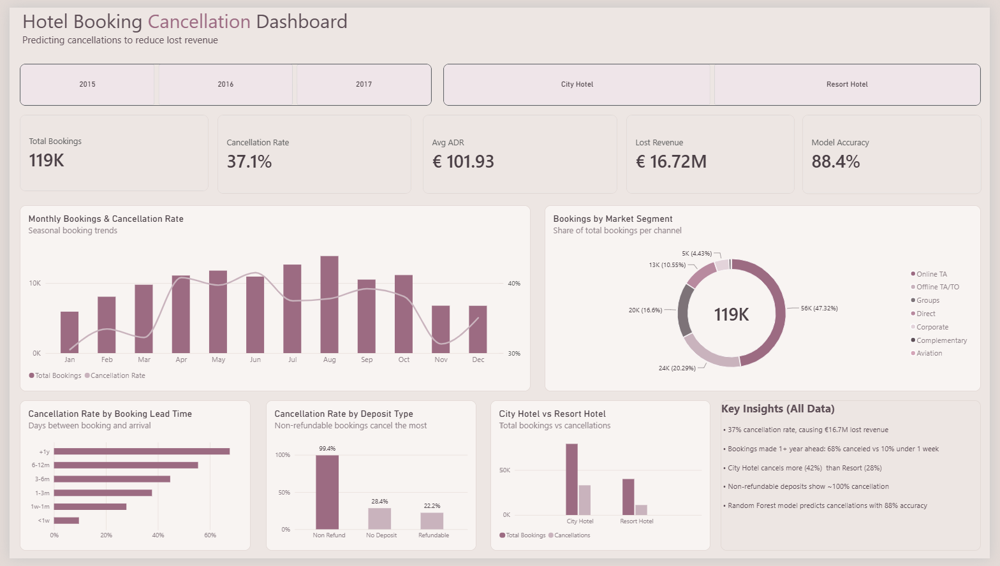

# 🏨 Hotel Booking Cancellation Prediction

An end-to-end data project: data cleaning, exploratory analysis, a machine learning model that predicts booking cancellations, an interactive Power BI dashboard, and a live prediction app.

**🔗 Live app:** [predict-hotel-cancellations.streamlit.app](https://predict-hotel-cancellations.streamlit.app)



## The problem

Hotels lose revenue when guests cancel. In this dataset, **37% of bookings were canceled**, costing about **€16.7M** in lost revenue. Predicting which bookings are likely to cancel helps hotels plan overbooking, deposits and reminders.

## Dataset

[Hotel Booking Demand](https://www.kaggle.com/datasets/jessemostipak/hotel-booking-demand) on Kaggle: about 119K bookings from a city hotel and a resort hotel in Portugal (July 2015 to August 2017).

## What I did

1. **Cleaning:** handled missing values, removed invalid bookings (zero guests, negative prices), and added `total_nights` and `revenue`.
2. **Exploratory analysis:** studied cancellations by lead time, season, hotel type, deposit type and booking channel.
3. **Modeling:** compared Logistic Regression and Random Forest, and removed leakage columns (`reservation_status`) so the results are honest.
4. **Dashboard:** built an interactive Power BI dashboard with KPIs, filters and key insights.
5. **App:** deployed a Streamlit app that predicts the cancellation probability of a new booking.

## Results

| Model | Accuracy | F1 | ROC-AUC |
|---|---|---|---|
| Logistic Regression | 80.8% | 0.709 | 0.886 |
| **Random Forest** | **88.4%** | **0.836** | **0.953** |

The app uses a lighter Random Forest trained on 12 easy-to-enter features (Accuracy 83.2%, F1 0.743, ROC-AUC 0.904), so anyone can try it without filling in all 30+ columns.

## Key insights

- Bookings made **1+ year ahead** cancel **68%** of the time, versus **10%** for bookings made less than a week ahead.
- The **City Hotel** cancels more often (**42%**) than the **Resort Hotel** (**28%**).
- **Non-refundable** deposits show about **99%** cancellation, likely bulk group bookings by agencies.
- **Lead time** is the strongest predictor in the model.

## Project structure

```
├── app.py                              # Streamlit prediction app
├── model.pkl                           # trained model used by the app
├── train_model.py                      # script that trains model.pkl (needs hotel_clean.csv)
├── requirements.txt
├── .streamlit/config.toml              # app theme
├── hotel_cancellation_analysis.ipynb   # cleaning, EDA and modeling
├── Hotel_Dashboard.pbix                # Power BI dashboard
└── dashboard.png                       # dashboard screenshot
```

## Run it locally

```bash
pip install -r requirements.txt
streamlit run app.py
```

## Retrain the app model

`train_model.py` expects `hotel_clean.csv`, which is not stored in this repo to keep it light. To create it, run the notebook on the [Kaggle dataset](https://www.kaggle.com/datasets/jessemostipak/hotel-booking-demand) up to section 6 (*Export the clean data*), then run:

```bash
python train_model.py
```

## Tools

Python (pandas, scikit-learn, matplotlib, seaborn), Power BI, Streamlit

## License

MIT
